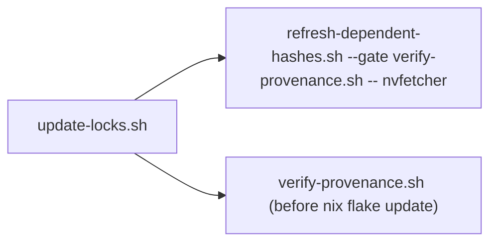

# Agent Instructions

This project uses **bd** (beads) for issue tracking. Run `bd prime` for full workflow context.

## Beads Labels

Every bead filed against this repo MUST carry the repo label `overlay`.

If the bead concerns one specific package, it MUST also carry that package's label. The project
label is the basename of the top-level directory under `packages/` that the bead's subject matter
lives in (e.g. `packages/cmux` → `cmux`, `packages/gh-stack` → `gh-stack`). Run `ls packages` for
the current valid set: that directory listing IS the source of truth, not an enumerated table
here, so it cannot go stale as packages are added, removed, or renamed.

A bead about repo-wide or cross-cutting concerns (flake-level, CI, update-locks, docs shared across
packages) MUST carry only the repo label, no project label.

## Quick Reference

```bash
bd ready              # Find available work
bd show <id>          # View issue details
bd update <id> --claim  # Claim work atomically
bd close <id>         # Complete work
bd dolt push          # Push beads data to remote
```

## Non-Interactive Shell Commands

**ALWAYS use non-interactive flags** with file operations to avoid hanging on confirmation prompts.

Shell commands like `cp`, `mv`, and `rm` may be aliased to include `-i` (interactive) mode on some systems, causing the agent to hang indefinitely waiting for y/n input.

**Use these forms instead:**

```bash
# Force overwrite without prompting
cp -f source dest           # NOT: cp source dest
mv -f source dest           # NOT: mv source dest
rm -f file                  # NOT: rm file

# For recursive operations
rm -rf directory            # NOT: rm -r directory
cp -rf source dest          # NOT: cp -r source dest
```

**Other commands that may prompt:**

- `scp` - use `-o BatchMode=yes` for non-interactive
- `ssh` - use `-o BatchMode=yes` to fail instead of prompting
- `apt-get` - use `-y` flag
- `brew` - use `HOMEBREW_NO_AUTO_UPDATE=1` env var

## Bash scripts outside mkBashBuilders

`update-locks.sh`, `refresh-dependent-hashes.sh` and `verify-provenance.sh` (repo root) are steps of
ONE updater pipeline. They are standalone developer utilities, not hooks, and are intentionally NOT
packaged with `mkBashScript`/`mkBashBuilders`.

Reason (operator ruling Phillip, 2026-10-28, pg2-sh005n row S1; verified in pg2-62pyym): the
builder could express them, but packaging is not practical. The pipeline MUST keep working when
this flake or its `flake.lock` is itself the artifact being repaired. `update-locks.sh` resolves
its library through `nix run`, re-execs into the devShell, and falls back to
`nix run nixpkgs#nvfetcher` so the updater stays bootstrappable. It then invokes
`"$SCRIPT_DIR/refresh-dependent-hashes.sh"` and `"$SCRIPT_DIR/verify-provenance.sh"` by path, and
runs `verify-provenance.sh` BEFORE `nix flake update`. Packaging the two sub-scripts would force
that step to depend on the overlay flake evaluating with a valid lock, the dependency
`update-locks.sh` removes. The bats checks also copy each script into a sandbox and source it by
relative path, which the current layout serves directly.



Rules:

- These three scripts MAY stay outside `mkBashScript` while the contract above holds (invoked by
  `$SCRIPT_DIR` path from `update-locks.sh`, usable when the flake or lock is broken).
- A script added to this pipeline MUST be listed in this section.
- Each listed script MUST carry the header line `# Standalone developer utility — not Nix-wrapped intentionally`
  with a pointer to this section.
- A script that is not part of the pipeline, or that no longer needs to run with a broken
  flake/lock, SHOULD use `mkBashScript`.

<!-- BEGIN BEADS INTEGRATION v:1 profile:minimal hash:ca08a54f -->

## Beads Issue Tracker

This project uses **bd (beads)** for issue tracking. Run `bd prime` to see full workflow context and commands.

### Quick Reference

```bash
bd ready              # Find available work
bd show <id>          # View issue details
bd update <id> --claim  # Claim work
bd close <id>         # Complete work
```

### Rules

- Use `bd` for ALL task tracking — do NOT use TodoWrite, TaskCreate, or markdown TODO lists
- Run `bd prime` for detailed command reference and session close protocol
- Use `bd remember` for persistent knowledge — do NOT use MEMORY.md files
<!-- END BEADS INTEGRATION -->
