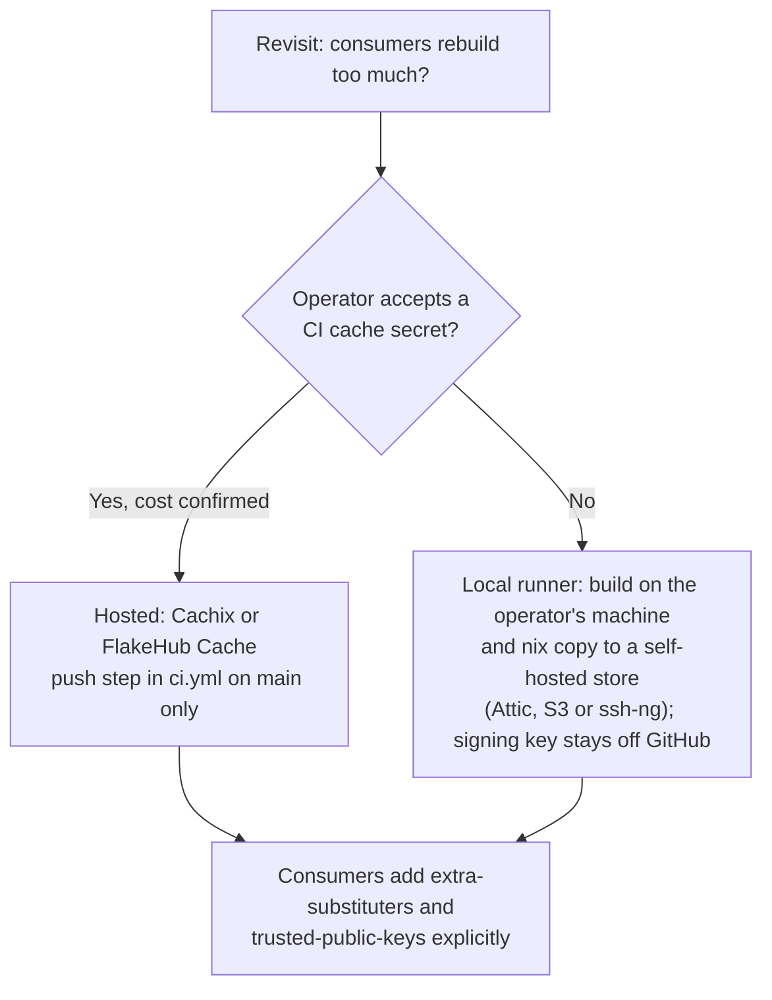

# No binary cache for consumers (for now)

**Status**: Proposed
**Date**: 2026-10-28
**Deciders**: Phillip Green II (acknowledgement pending); drafted by an agent under bead pg2-7t8zys
**Bead**: pg2-7t8zys (also tracked as pg2-od2h0x, deep review finding U6)

## Context

Finding U6 of `2026-06-12-nix-overlay-deepdive.md` ("No binary cache for consumers", Low) says CI
builds and pushes nothing, so consumers rebuild this repo's packages locally. Its recommendation was
"once T1 makes CI build packages, push to Cachix or FlakeHub Cache". The bead asks for a first
re-verification of U6 and T1 against current HEAD, then a recorded decision.

State at HEAD on 2026-10-28:

- **T1 is resolved.** `flake.nix` sets `checks = config.packages // versionChecks // { ... }`, so
  `nix flake check` builds every exported package. `.github/workflows/ci.yml` runs
  `nix flake check --all-systems` on `ubuntu-latest` and `macos-latest`, so the runner's own system is
  built and the other systems are evaluated only.
- **U6 is still true.** Outside the deepdive and two dated `docs/superpowers` snapshots, the repo has no
  `extra-substituters`, `trusted-public-keys`, `nixConfig`, Cachix, FlakeHub Cache, Attic or
  `magic-nix-cache` configuration. `ci.yml` runs `accept-flake-config = true` and
  `nix-community/cache-nix-action` (a CI-side store cache restored for the same job, not a cache that
  consumers can use). The stray `id-token: write` that hinted at FlakeHub Cache was deleted in the
  chunk-6 tidy (`docs/superpowers/specs/2026-06-18-chunk6-trust-and-tidy-design.md`, finding S6).
- **The cost premise is weaker than the deepdive stated.** Of the packages in `packages/`, `cmux`,
  `eclipse-java` and `logseq` unpack a `.dmg` with `7zz` (seconds of CPU, no compile), and the plugin
  and syntax packages are fetch and install. The from-source builds are `gh-stack`, `glowm`, `gomu` and
  `pint` (Go) and `mdr-rs` (Rust). Those are the only packages a cache would save real time on, and all
  of them are ordinary Go or Rust builds (no build time was measured for this ADR).
- **No prior ruling against a cache was found.** `bd search` for "binary cache", "cachix" and
  "substituter" finds only this bead, its duplicate pg2-od2h0x, and unrelated closed beads (pg2-o817r
  records that a blanket `accept-flake-config` trust of flake-declared substituters was judged a
  hygiene problem; pg2-3jvey and pg2-bvldq are unrelated). So the question is open, not
  decided-against.

Constraints that bound any implementation:

- The workspace rules say no GitHub App CI secrets and no re-enabling scheduled Actions on private
  repos, with a local runner as the alternative. This repository is public (ADR 0001), so that ruling
  does not strictly govern it, but `update-flakes.yml` already passes `secrets: inherit` to a reusable
  workflow, and a cache write token would be a new CI secret. Adding one is an operator decision, not
  an agent default.
- Every hosted option (Cachix, FlakeHub Cache) has a free quota or paid tier. The cost has not been
  confirmed with the operator. An agent MUST NOT choose a paid or quota-limited service on its own.
- Consumers (`nix-personal`, `nix-agent-support`, `nix-support-apps`, `nix-ziprecruiter`) would each
  need an explicit `extra-substituters` and `trusted-public-keys` entry. A flake-level `nixConfig` only
  takes effect with `accept-flake-config`, which pg2-o817r flagged as a blanket-trust problem, so the
  consumer side is real work in four repos, not a one-line change here.

## Decision

This repository MUST NOT publish a binary cache at this time. The cost (an external service or a
self-hosted host, a signing or write secret, and consumer configuration in four repos) is larger than
the saving (a few minutes of local compile for five from-source packages, rebuilt only when their
version bumps).

CI MUST continue to build every package (T1), because that is what makes a later cache cheap to add.

The following MUST NOT be added under this decision: a GitHub Actions secret or OIDC grant for cache
writes, a hosted cache account, or `nixConfig` substituter entries in `flake.nix`.

### Viable shapes if the decision is revisited

- A local-runner push (build on the operator's machine, `nix copy` to a self-hosted store, signing key
  never leaving the machine) MUST be the first option considered, because it needs no CI secret and fits
  the workspace's local-runner stance. It needs a host that stays reachable from every consumer, which
  does not exist today.
- A hosted cache SHOULD be considered only after the operator confirms the cost and accepts the secret.
  Its push step MUST run on `push` to `main`, never on `pull_request`, so a pull request cannot write to
  the cache.
- Any option MUST configure the substituter and public key explicitly in each consumer's nix settings
  and MUST NOT rely on `accept-flake-config` to deliver them.

## Conditions to revisit

This ADR SHOULD be revisited when any of these becomes true:

1. A from-source package whose build takes noticeably long (for example a large Rust, Electron or
   LLVM-dependent package) is added, or `mdr-rs` or a Go package grows to do so.
2. A consumer's `pn workspace build` repeatedly shows the overlay's packages as the dominant local build
   cost (measure it first; this ADR has no measurement).
3. The operator provides, or approves the cost of, a cache host or hosted account and accepts the
   resulting secret or local-runner arrangement.
4. A second machine class (CI image, a new laptop, a Linux builder) needs these packages and cannot
   cheaply build them.

When revisiting, a new ADR SHOULD supersede this one rather than edit it.

## Consequences

### Positive

- No new secret, service, cost or consumer configuration.
- CI already proves every package builds, so a later cache has no missing prerequisite.
- The decision, its premise and its revisit triggers are searchable, so a later agent does not re-file U6
  from the deepdive without the corrected facts above.

### Negative

- Consumers keep compiling the five from-source packages locally after each version bump.

### Neutral

- Closing U6 as "no cache wanted" satisfies the bead's acceptance criteria without altering any runtime
  behavior.

## Alternatives Considered

### Cachix

**Deferred**: Needs an account, a write token as a CI secret, and a cost check (plan limits and price not confirmed).
All three are operator decisions.

### FlakeHub Cache

**Deferred**: Needs the `id-token: write` OIDC grant that chunk-6 deliberately removed, plus a
FlakeHub plan (price not confirmed). Same operator decisions.

### Local-runner push to a self-hosted store

**Deferred, preferred if revisited**: Best fit with the workspace's local-runner stance, but it needs a
host that stays reachable by every consumer, which does not exist today.

### `nixConfig` substituters in `flake.nix`

**Rejected**: Only honored with `accept-flake-config`, which pg2-o817r treated as blanket trust of
flake-declared substituters.

## Related Decisions

See also: this repo `docs/adr/0001-purpose-of-this-repo.md` (packages are consumed by flake input and
overlay in other repos).
