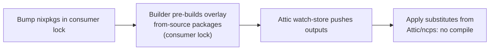

# Pre-build the overlay's from-source packages after a nixpkgs bump

**Status**: Proposed
**Date**: 2026-11-23
**Deciders**: Phillip Green II (acknowledgement pending); drafted by an agent
**Supersedes**: [ADR 0003](0003-no-binary-cache-for-consumers.md)

## Context

ADR 0003 decided against a binary cache because it assumed "a few minutes of local compile" for the
from-source packages, and listed revisit conditions. Evidence now contradicts that premise. The homelab
research note `docs/research/mdr-rs-remote-build-cache-miss.md` (homelab repository, 2026-11-23) records
that the 2026-11-22 monorepod apply spent 30+ minutes in `cargo build --release` for `mdr-rs` on the
remote builder (`-j 2`). Findings that matter here:

- A cache host now exists: Attic plus an `ncps` proxy, both trusted by the consumer host. It is populated
  only by the builder's Attic `watch-store` service, which pushes after the builder builds something.
  This repository's CI builds every package but pushes nowhere.
- `mdr-rs` is `callPackage`d on the consumer's `final` package set, and this flake's `nixpkgs` input
  follows the consumer's nixpkgs. Its derivation hash therefore changes with every consumer nixpkgs
  bump (stdenv, rustc, cargo hooks, webkitgtk), even when the `mdr-rs` version and `Cargo.lock` are
  unchanged.
- So the first apply after any bump finds no cached output and pays the full source build. This is
  structural, not a malfunction. ADR 0003 revisit conditions 2 (measured dominant cost) and 3 (a cache
  host exists) are met.

A consequence for the design: a build in this repository's CI uses this repository's own `flake.lock`
nixpkgs, so its outputs have different store paths from the ones a consumer needs. Pre-building in this
repository's CI cannot warm the consumer's cache. The pre-build MUST run against the consumer's lock.

## Decision

The overlay's from-source packages (`mdr-rs`, `gh-stack`, `glowm`, `gomu`, `pint`, and any later
addition that compiles) MUST be pre-built on the consumer's builder, against the consumer's updated
`flake.lock`, after a nixpkgs bump and before the apply that needs them. The existing Attic `watch-store`
service then publishes the outputs, so no new cache, secret or consumer substituter configuration is
introduced.

- The pre-build MUST be a step of the consumer's bump workflow (in the current topology: homelab, where
  the nixpkgs bump is committed), running on the builder after the lock is updated. It SHOULD build the
  overlay's package set as the consumer instantiates it (for example
  `nix build --no-link .#<consumer attribute that includes the overlay packages>`), not this repository's
  `packages` output.
- The bump MUST NOT be considered ready to apply until the pre-build has succeeded, so the apply finds
  every from-source output cached.
- This repository MUST keep building every package in CI (it proves the packages build) but MUST NOT
  add a cache write secret, OIDC grant or `nixConfig` substituter entries for this purpose.
- This repository SHOULD expose a stable way to enumerate its from-source packages (for example a
  `passthru`-free list in a flake output) so the consumer's step does not hard-code names. That is a
  follow-up, not a precondition.
- Consumers SHOULD set `fallback = false` (or equivalent) where a failed substitution should surface
  rather than silently compile; this is the consumer's decision and is noted here only as a latent risk
  recorded by the research.

## Consequences

### Positive

- The 30+ minute compile moves off the critical path of the apply, and happens once on the machine that
  already populates the cache.
- No new service, secret, cost or consumer configuration; reuses the existing cache and trust setup.

### Negative

- The pre-build step is owned by the consumer (homelab), so this repository cannot enforce it; the
  decision is only effective once the consumer implements it.
- The bump workflow gains a long step (the same compile, now earlier).
- Other consumers on their own lock (for example a laptop) are not covered unless they share the same
  builder or cache.

## Alternatives Considered

### Pre-build and push from this repository's CI

**Rejected**: CI uses this repository's lock, so store paths differ from the consumer's and the cache
entries would never be hit. It would also need a CI cache-write secret.

### Do nothing (ADR 0003)

**Rejected**: Every nixpkgs bump costs one 30+ minute first apply; the premise of "a few minutes" was
measured as wrong.

### Hosted cache (Cachix, FlakeHub Cache)

**Rejected for now**: Same lock-mismatch problem unless built against the consumer lock, plus cost and a
secret, while a self-hosted cache already exists.

### Pin `mdr-rs` to a nixpkgs that does not move

**Rejected**: Defeats the purpose of following the consumer's nixpkgs and splits toolchains.

## Related Decisions

Supersedes [ADR 0003](0003-no-binary-cache-for-consumers.md). See also
[ADR 0001](0001-purpose-of-this-repo.md).
