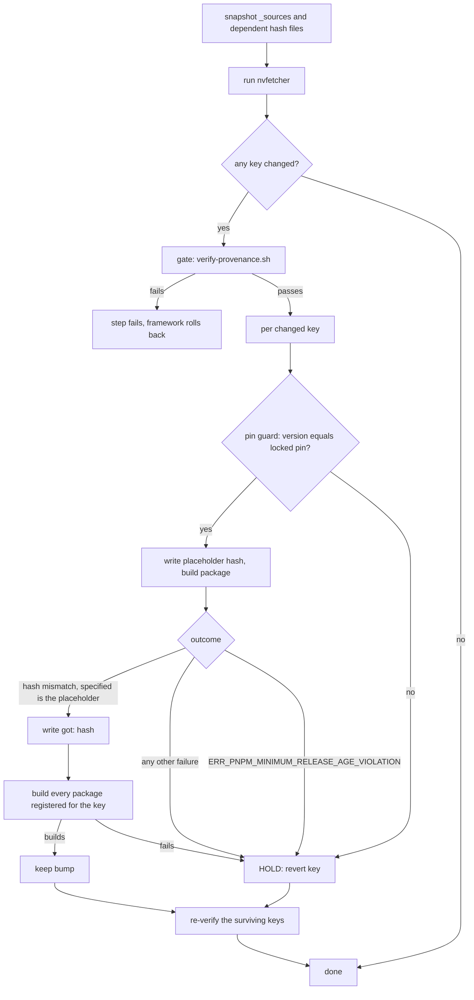

# update-locks: dependent fixed-output hashes

Bead pg2-g39wh. `nvfetcher` moves a package's source (`_sources/`), but some packages carry a hash
that is **derived from** that source: a pnpm dependency store, a Go vendor tree, a cargo lock. When
upstream changes its dependencies, the old hash no longer matches, and the auto-landed bump breaks
the system build (mermaid-live-editor, 2026-10-13: `ERR_PNPM_NO_OFFLINE_TARBALL`). A bumped package
can also stop building outright (cmux 0.65.1, 2026-10-13, pg2-ybbs8).

`refresh-dependent-hashes.sh` closes that gap. `update-locks.sh` runs the `nvfetcher` step **through**
it.

## Policy

- A source bump MUST NOT land with a stale dependent hash. The step MUST recompute it.
- A source bump MUST NOT land when its package no longer builds. The step MUST hold that bump.
- A held bump MUST be reverted for that key only. Other keys' bumps MUST still land.
- A held bump MUST be reported with its reason and MUST be retried by the next run.
- The step MUST NOT override pnpm's `minimumReleaseAge` policy and MUST NOT write a guessed hash.
- A source that is new (no earlier entry to revert to) MUST fail the step when it does not build.
- A source whose version the locked `nix-repo-base` does not pin MUST be held (see "Pin guard").
- The provenance gate (`verify-provenance.sh`) MUST run before any build of a bumped source, and it
  is unchanged. The separate `verify-provenance` step still runs every time.

## Flow



The placeholder build is deliberate. With the stale hash, the fixed-output derivation's output path
is already in the store, so nix never refetches and the stale dependency tree is reused; the failure
then appears only in the consuming build. Only a build whose hash is unknown forces a fresh fetch and
gives nix's own `got:` value. The `specified:` value in the mismatch MUST equal the placeholder, so
the `got:` of an unrelated fixed-output derivation (such as the source itself) is never written.

## Pin guard (bead pg2-bvudh)

Some sources must stay in lockstep with a version another repo pins. `gomu` is the case:
`nix-repo-base`'s `pg-go-mutate` pins the engine version in
`modules/pg-go-mutate/pg-go-mutate/gomu-pin.nix`, and `home/pg-go-mutate` asserts at eval time that
the engine built from `sources.gomu` reports that same string. On 2026-10-19 `nvfetcher` moved gomu
v0.2.1 -> v0.3.0 while the pin still said 0.2.1; the eval assertion then aborted
`pn workspace build`, and the skew was only found in a downstream consumer build.

The overlay consumes `nix-repo-base` (flake input), never the reverse (spec W6, an input cycle), so the
sweep cannot bump both. The two repos need a coordinated bump (spec W16): pin first in `nix-repo-base`,
push, relock here, and only then may the source move.

- A source registered in `PIN_GUARDS` MUST NOT land a version that differs from the version pinned in
  the named file of the flake input **as locked in `flake.lock`**. A leading `v` on the source version
  is ignored (the tag is `v0.3.0`, the pin is `0.3.0`).
- A mismatching bump MUST be held: that key's `_sources` entry (and its hash files) are restored from
  the snapshot and the run reports `HELD <key> ...` naming both versions and the coordinated bump
  needed. Other keys' bumps MUST still land.
- A pin that cannot be read (no lock entry, tree not fetchable, file missing) MUST hold the bump too.
  An unreadable pin is not a match.
- The check MUST be the cheap version-string comparison and MUST NOT build anything. It runs before
  the hash refresh and the build of the key.
- A held bump is retried on every run. It lands on the first run whose locked `nix-repo-base` pins the
  new version, which is the operator's push-then-relock; the `nix-flake-update` step runs after the
  `nvfetcher` step, so a pin pushed just before a run is seen by the following run.

The pin is read with `builtins.fetchTree` of the input's `locked` attributes from `flake.lock`
(`RDH_LOCK_FILE` overrides the file in tests). That reads exactly the bytes the consumer build sees,
and works offline whenever that tree is already in the store (a github lock carries a `narHash`). It
costs well under a second there.

| nvfetcher key | Flake input               | Pin file                                         |
| ------------- | ------------------------- | ------------------------------------------------ |
| `gomu`        | `phillipgreenii-nix-base` | `modules/pg-go-mutate/pg-go-mutate/gomu-pin.nix` |

## pnpm minimumReleaseAge

pnpm 11 rejects a dependency published within roughly the last day
(`ERR_PNPM_MINIMUM_RELEASE_AGE_VIOLATION`). A bump whose new lockfile pulls such a package cannot have
its hash computed yet. The step reports `HELD <key> ... pnpm minimumReleaseAge: ...`, reverts the key,
and tries again on the next run, once the dependency has aged. See pg2-kwuw0.

## Manual use

Recompute (and build-verify) one package's dependent hash without a source bump:

```bash
pg-nix-log-wrapped ./refresh-dependent-hashes.sh --force pint
```

## Real-nix integration suite

`tests/refresh-dependent-hashes-nix.bats` runs the real script with a real `nix build` and real
fixed-output `got:` mismatches against a throwaway fixture flake. It is tagged `type:integration`
(rule V-4), so the unit-tier `run-unit-tests` commit hook and `pg-hooks run pre-land` do NOT run it,
and it cannot be a sandboxed `checks.*` entry (it needs a nix daemon that can run a local builder).
The pure half (`tests/refresh-dependent-hashes.bats`) stays `type:unit` and is the
`refresh-dependent-hashes-tests` check. Run the integration half on demand, from the repo root:

```bash
pg-nix-log-wrapped nix run .#refresh-dependent-hashes-nix-tests
# equivalent, with bats on PATH:
bats --filter-tags type:integration tests/refresh-dependent-hashes-nix.bats
```

## Inventory

Every overlay package whose build input depends on its source in a way `nvfetcher` does not itself
update. The registry lives at the top of `refresh-dependent-hashes.sh` (`HASH_DEPS`, `MANUAL_DEPS`,
`BUILD_ATTRS`); `tests/refresh-dependent-hashes.bats` fails when this inventory and the code drift:
every `nvfetcher.toml` key MUST be in `BUILD_ATTRS`, and every package directory with a hash literal,
pnpm/npm/yarn fetch, or cargo lock MUST be in `HASH_DEPS` or `MANUAL_DEPS`.

### Refreshed automatically (`HASH_DEPS`)

| nvfetcher key         | File                                       | Literal      | Kind                        |
| --------------------- | ------------------------------------------ | ------------ | --------------------------- |
| `gh-stack`            | `packages/gh-stack/default.nix`            | `vendorHash` | `buildGoModule` vendor tree |
| `glowm`               | `packages/glowm/default.nix`               | `vendorHash` | `buildGoModule` vendor tree |
| `gomu`                | `packages/gomu/default.nix`                | `vendorHash` | `buildGoModule` vendor tree |
| `pint`                | `packages/pint/default.nix`                | `vendorHash` | `buildGoModule` vendor tree |
| `mermaid-ink`         | `packages/mermaid-ink/default.nix`         | `hash`       | `fetchPnpmDeps` (pnpm_11)   |
| `mermaid-live-editor` | `packages/mermaid-live-editor/default.nix` | `hash`       | `fetchPnpmDeps` (pnpm_11)   |

The pnpm version is also part of the pnpm hashes: changing the `pnpm` package or `fetcherVersion` in
these files changes the correct hash. Changing `goVersion` for `pint` likewise changes `vendorHash`. Those
are NOT source bumps, so refresh by hand with `--force <key>`.

### Verified, held on failure, not refreshed (`MANUAL_DEPS`)

| nvfetcher key | File                         | Why it is not refreshed                                                                                                    |
| ------------- | ---------------------------- | -------------------------------------------------------------------------------------------------------------------------- |
| `mdr-rs`      | `packages/mdr-rs/Cargo.lock` | Hand-copied copy of upstream's lock (`cargoLock.lockFile`), not a hash. A bump that breaks it fails the build and is held. |

### No dependent hash; build-verified only (`BUILD_ATTRS`)

These have no source-derived hash literal. The step still builds them after a bump and holds the bump
when the build fails (the cmux class).

| nvfetcher key                                                               | Built attr (aarch64-darwin only marked \*)                    |
| --------------------------------------------------------------------------- | ------------------------------------------------------------- |
| `cmux`                                                                      | `cmux` \*                                                     |
| `logseq`                                                                    | `logseq` \*                                                   |
| `eclipse-java`                                                              | `eclipse-java` \*, `eclipse-with-gradleimport` \*             |
| `lombok`                                                                    | `eclipse-with-gradleimport` \*                                |
| `bat-gherkin-syntax`, `tmux-*`, `bunny` (`yaziPlugins-bunny`), `icons-brew` | the package of the same name (plain `fetchFromGitHub` source) |

On a system that does not expose an attr (the `*` ones on Linux) the step logs `skipping build of ...`
and the bump is not verified there.

### Not covered

- Any `hash` that depends on something other than the nvfetcher source (a toolchain change). Use
  `--force`.
- Dependencies pulled from nixpkgs (no hash in this repo).
